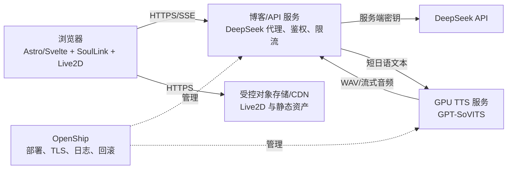

# 吸血鬼 Live2D 线上部署评估

更新时间：2026-07-27

## 结论

技术上可以上线，但不能把当前本地开发进程原样搬到 Vercel 或普通无 GPU 的服务器。

- 保留当前 Astro/Svelte、SoulLink、Pixi Live2D 前端，不需要重写界面。
- DeepSeek 必须继续由服务端代理，`AI_API_KEY` 不得进入浏览器。
- GPT-SoVITS 应拆成独立的常驻 GPU 推理服务，通过 HTTPS 提供短日语语音。
- Live2D 模型应放在受控对象存储或 CDN；上线前必须确认模型和 Cubism Core 的公开分发授权。
- OpenShip 适合作为部署控制面，不是 Live2D、LLM 或 TTS 运行框架。

## OpenShip 评估

评估仓库：[oblien/openship](https://github.com/oblien/openship)

截至 2026-07-27，GitHub 元数据显示该项目约 8.8k Stars、Apache-2.0、最新正式版本 `v0.3.0`，并在持续提交。README 明确支持 Docker Compose、Node、Python、WebSocket、域名、Let's Encrypt、推送部署和回滚。

适合本项目的能力：

- 在 Linux VPS 上部署博客/API 容器，并管理域名和 TLS。
- 部署单独的 GPT-SoVITS Compose 服务，或把请求转发到另一台 GPU 主机。
- 保存环境变量、查看日志、配置健康检查和执行回滚。
- 使用 GitHub 推送触发博客更新。

需要保留的风险：

- `v0.3.0` 仍是较早期版本，生产环境要固定版本，不能自动跟随 `main`。
- OpenShip README 虽声明 Compose 可原样部署，但本项目的 NVIDIA GPU 透传仍需在目标机上用 NVIDIA Container Toolkit 做一次实机验证。
- OpenShip API 容器会挂载 Docker Socket，部署控制面只能放在可信主机，并限制管理端访问。

## 推荐拓扑

首选做法是把网页/API 与 GPU TTS 分成两个服务。这样博客故障不会重启模型，TTS 也可以独立扩容、限流和缓存。

## 当前首发方案

用户已选择先复用本机 GPU，不购买云 GPU：

- Astro/Svelte 与同源 API 部署到 Vercel。
- Live2D、图片和视频计划放到阿里云 OSS/CDN。
- GPT-SoVITS 保持监听本机 `127.0.0.1:9880`。
- `scripts/tts-gateway.mjs` 在 `127.0.0.1:8788` 提供带 Bearer Token 的窄接口，只接收 `{ text, emotion }`。
- `scripts/tts-tunnel.mjs` 启动 GPT-SoVITS、网关与 Cloudflare Tunnel；Quick Tunnel 无需账号，仅用于预发布联调。
- `pnpm tts:online` 是 Quick Tunnel 的一键上线启动器：自动启动本机 TTS、更新 Vercel Production 的 `TTS_UPSTREAM_URL` 与 `TTS_SERVICE_TOKEN`，并重新部署。运行期间必须保持终端开启；每次重启会更新临时地址。
- Vercel 通过 `TTS_UPSTREAM_URL` 和 `TTS_SERVICE_TOKEN` 调用网关，Token 不进入浏览器。
- 本机离线或 Tunnel 不可用时，聊天文字仍可工作，TTS 接口返回 503。

本轮已验证 Quick Tunnel：未授权健康检查返回 401，授权健康检查返回 200，真实日语合成返回有效 `RIFF/WAVE`。Quick Tunnel 域名每次启动都会变化，正式上线仍需 Cloudflare 免费账号和固定域名 Tunnel，或替换为其他稳定穿透服务。

## 当前项目上线前缺口

1. 生产环境下 `xiaoConfig.stage.modelPath` 只读取 `PUBLIC_VAMPIRE_MODEL_URL`，本地 `/__local-vampire/` 代理只在开发模式存在。必须准备受控 HTTPS 模型地址。
2. 当前 Astro 使用 `@astrojs/vercel`，生产构建已经通过；Vercel 不运行 `package.json` 的本地联合开发启动器。
3. `/api/xiao/tts/` 已支持 `TTS_UPSTREAM_URL`、`TTS_SERVICE_TOKEN`、HTTPS 约束、同源检查和远程健康检查。
4. 本地网关已实现 Token 鉴权、请求体白名单、单并发队列、最大排队数与超时；正式域名 Tunnel 和 Vercel 环境变量尚待账号登录后配置。
5. `吸血鬼女生/注意事项.txt` 只列出作者、功能和 VTube Studio 用法，没有找到公开网络分发或商用授权条款。技术部署前应向资产来源方确认授权。
6. Cubism Core 当前使用 Live2D 官方远程脚本。线上使用需遵守 Live2D SDK/Core 的许可与署名要求。

## 框架选择

| 方案 | 结论 | 原因 |
| --- | --- | --- |
| 当前前端 + SoulLink + 独立 GPT-SoVITS | 推荐 | 已完成模型参数、情绪、动作、口型和页面布局，改动最小 |
| OpenShip | 推荐作为部署平台 | 能管理容器、TLS、CI/CD，但不替代应用逻辑 |
| Open-LLM-VTuber | 可借鉴后端，不建议整体替换 | 原生支持 Live2D、DeepSeek、GPTSoVITS、情绪映射和远程 Web；整体替换会丢失当前页面与 SoulLink 状态机 |
| OpenAvatarChat | 暂不采用 | 偏 RTC 与生成式说话头；Live2D 依赖社区前端，和当前 VTS 模型路径不如 Open-LLM-VTuber 直接 |

## 实施顺序

1. 确认 Live2D 模型公开分发授权，建立 OSS Bucket 和生产资源域名。
2. 注册 Cloudflare 免费账号并建立固定域名 Tunnel；本机无需开放路由器端口。
3. 在本机 `.env` 与 Vercel 中配置同一份 `TTS_SERVICE_TOKEN`，Vercel 配置固定 `TTS_UPSTREAM_URL`。
4. 把 Vercel 预发布域名加入 `ALLOWED_ORIGINS`，配置 DeepSeek 和管理端密钥。
5. 验证 OSS 的 CORS、Range、缓存和 Live2D 8192 纹理加载。
6. 在 HTTPS 预发布环境复跑 DeepSeek、TTS、口型、情绪动作和移动端测试。
7. 正式上线后监控本机在线率、Tunnel 健康和 TTS 队列；需要 24 小时可用时再迁移云 GPU。
