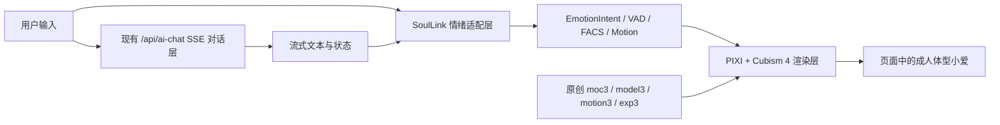

# SoulLink + Live2D 成人体型小爱页面构设

> 日期：2026-07-25  
> 状态：原创设定资产与 SoulLink 静态预览已落地，等待 Cubism 分层和绑定  
> 目标页面：`/xiao/`

## 结论

可以实现，但需要把三个问题分开：

- SoulLink Emotion SDK 负责把情绪意图映射成 VAD、FACS/AU、表情、动作和 Live2D 参数。
- Live2D 渲染器负责加载已经制作好的 Cubism 4 模型并逐帧写入参数。
- imagegen 负责概念图、角色设定稿和立绘源图，不能自动完成 PSD 拆层、ArtMesh、Deformer、物理和动作绑定。

SoulLink 当前只有 `0.1.0-beta.1`，仓库提交和贡献者都很少，没有浏览器 E2E 与稳定版发布记录。它适合先做技术 Spike，不应成为不可替换的核心依赖。

当前已通过 pnpm 安装 `@soullink-emotion/engine@0.1.0-beta.1`，并用项目自己的适配层驱动 `/xiao/` 静态人物预览。只有取得真正的 Cubism 模型后，才需要继续安装渲染适配依赖：

```bash
pnpm add @soullink-emotion/live2d-pixi@0.1.0-beta.1 \
  pixi.js@7.4.3 \
  pixi-live2d-display@0.5.0-beta
```

## 当前实现与资产

- `/xiao/` 已接入常驻对话控制器、VAD/FACS 情绪遥测、暂停与页面可见性优化，并明确显示 `STATIC PREVIEW`。
- 当前人物会随 SoulLink 快照产生呼吸、视线、头部和情绪变化，但它仍是静态立绘的网页动画，不是 `.moc3` Live2D。
- 九秋 imagegen 技能已安装并用于生成原创身份锚点、三视图、表情/口型/手势板、拆层图和页面舞台人物。
- 生成资产位于 `public/assets/images/xiao/`；身份锚点任务为 `3958`，设定板任务为 `3961`、`3962`、`3963`。
- operation、task、派生关系、尺寸与 SHA-256 记录在 `docs/xiao-imagegen-provenance.json`，由 `tests/unit/xiao-asset-provenance.mjs` 自动校验。
- 真正 Live2D 仍需人工补全遮挡区域、分层 PSD、Cubism ArtMesh/Deformer/Physics 绑定，并导出 `.moc3`、`model3.json`、表情和动作文件。

## 系统边界



### 对话层

保留现有 `/api/ai-chat` 的 SSE、停止生成、历史记录、Vectorize/RAG 和错误处理。SoulLink 的 Planner 是非流式能力，不能替代现有聊天链。

当前 `/xiao/` 只是调用 `requestAISearchToggle()` 打开全局 AI 搜索弹窗，不能直接变成右侧常驻聊天。实施时先把 `AISearch.svelte` 的请求、AbortController、历史记录和 SSE 事件解析抽成共享 chat store/controller，再分别提供弹窗 UI 与 `/xiao/` 嵌入式 transcript/composer；禁止复制第二套请求和停止逻辑。

建议交互时序：

1. 用户发送消息后，立即以本地规则或服务端元数据得到初步情绪。
2. SoulLink 驱动倾听、思考和基础表情，现有接口继续流式输出文本。
3. 首个 token 到达后切换为说话状态；结束后落到最终情绪与 idle。
4. TTS 后续接入时只补充口型与播放状态，不在浏览器保存长期密钥。

状态必须覆盖 `loading → listening → thinking → speaking → idle`，并有独立的 `error` 与 `offline` 降级。`abort` 立即结束 speaking 并回到 idle；`error` 停止口型、保留可重试提示；在服务端尚未输出 emotion 事件前，情绪分类只在客户端 engine 中完成。

### 情绪层

把 SoulLink 包装成项目自己的 `XiaoEmotionAdapter`，页面只依赖项目接口。每帧必须同时应用 SoulLink 的 `live2dParams` 与 `nativeAnimation`，不能只返回一组参数：

```ts
type XiaoRuntimeSnapshot = {
	live2dParams: Record<string, number>;
	nativeAnimation: {
		expression?: string;
		motion?: string;
	};
};

type XiaoEmotionAdapter = {
	setIntent(intent: EmotionIntent): void;
	setSpeaking(active: boolean): void;
	update(deltaMs: number): XiaoRuntimeSnapshot;
	destroy(): void;
};
```

这样 SDK 版本、分类器或渲染适配器失效时可以替换，不污染对话和页面组件。

### 渲染层

- 仅在 `/xiao/` 的 Svelte `onMount` 中动态导入 PIXI 与 Live2D，避免拖慢全站。
- Swup 离页和组件卸载时执行 `session.stop()`、取消 RAF、销毁 renderer 和纹理。
- 模型 Profile 在本地或 CI 生成后作为静态文件发布；`profile-generator` 依赖 Node 文件系统，不能放进 Cloudflare Worker。
- 桌面端加载完整模型；移动端提供低纹理版本和静态海报降级。

### 与现有看板娘的排他关系

当前全局 `Live2DWidget` 会向 `window.PIXI` 注入 PIXI 6.5.10，而 SoulLink 的 `live2d-pixi` 路径要求 PIXI 7.4.3。`/xiao/` 必须在布局层禁用并卸载旧看板娘，再由页面私有模块加载 PIXI 7；不能让两套渲染器同时写入同一个全局对象。另一条可选路线是先把全局看板娘统一迁移到 PIXI 7，但这应作为单独项目验证，不能夹在小爱页面实现中。

现有看板娘配置注释声称许可登记前不进入公开运行时，但当前配置仍为启用状态。正式发布前必须完成 Cubism SDK 与模型资产授权登记，或真正关闭相关公开加载，不能只依赖注释。

## 原创模型生产流程

1. imagegen 生成无版权角色相似性的成年女性设定稿和正面全身基准图。
2. 人工拆分并补全被遮挡区域：前后发、眉眼、眼球、眼睑、鼻、嘴形、脸、颈、躯干、上臂、前臂、手、腿、服装和配件。
3. 制作分层 PSD，在 Cubism Editor 中完成 ArtMesh、Deformer、参数和物理绑定。
4. 导出 `moc3`、`model3.json`、纹理、`physics3.json`、`cdi3.json`、`exp3.json` 与 `motion3.json`。
5. 用 SoulLink Profile 映射已有参数，再逐项校准眼、眉、嘴、头、身体和呼吸。
6. 手臂、腿部、服装机关等全身动作使用模型师制作的 motion3 或私有参数，不能依赖默认面部映射。

最低绑定清单包括：`ParamAngleX/Y/Z`、身体角度、双眼开合与眼球 X/Y、双眉、嘴形与 `MouthOpenY`、呼吸；同时验收绘制顺序、Clipping Mask、Glue、头发与衣物 physics、基础口型、手臂/腿部 motion3，以及每个参数的范围和中性值。绿幕 PNG 只能作为拆层和补画参考，不能直接作为最终 rig 输入。

现有历史 Cubism 模型只可用于本地技术 Spike。其许可尚未完成公开运行时登记，也不是用户要求的原创成人体型小爱，不能作为最终交付资产。

## 页面构设

### 桌面端

- 首屏为实际可用的共鸣终端，不做营销落地页。
- 左侧约 62% 是无框、全高的 Live2D 舞台，角色完整展示到脚部；背景为近黑中性数字工作室和明确地面。
- 右侧约 38% 是常驻对话区，直接复用现有消息流、输入框、停止生成和历史入口，不再先弹独立聊天框。
- 顶部是 40-48px 细状态轨：在线状态、当前情绪、声音、特效、全屏和设置。
- 模型加载时在舞台原位显示轻量进度和重试，不弹额外模态框；离线时保留聊天记录与静态角色海报。
- 首屏底部露出下一段“今日心想”的一小部分，提示页面仍可继续滚动。
- 下方保留“今日心想”和“官方影像”，沿用当前线性分栏，只替换非原创人物背景。

视觉原则：

- 延续博客的极简黑白和 1px 分隔线，面板圆角不超过 8px。
- 青色与信号品红只标记在线、录音、情绪和选中态，不铺成单一霓虹主题。
- 可加入克制的扫描线、相机标尺、参数刻度和音频波形。
- 不使用玻璃卡套卡、发光球、雾化渐变、厚投影或密集 HUD。

### 移动端

- 舞台高 `42-48svh`，默认展示腰上或膝上构图，保证脸和手势可读。
- 聊天区是可展开的底部 Sheet；输入框和停止按钮始终可达。
- WebGL 不可用、低性能或减少动画时使用静态原创立绘，不下载完整模型。
- 顶部只保留情绪、声音和设置三个必要控制。
- 底部 Sheet 支持键盘焦点循环、屏幕阅读器状态播报和安全区内边距；输入框、停止与重试始终可达。

## Image2 整页概念图 Prompt

用途：先生成一张 `3840x2160` 非透明桌面 UI 概念图，用户确认后再按图实现页面。

```text
Use case: ui-mockup
Asset type: 3840x2160 desktop website concept screenshot
Primary request: Design the actual first screen of an immersive personal-blog AI companion page, not a marketing landing page. The original companion is named Xiao Ai, a clearly adult anime woman with mature 24-28-year-old proportions. She is elegant, intelligent and warm, standing slightly left of center in a calm three-quarter frontal pose. Her full body, hands and feet are visible and easy to inspect. Use original facial features and costume design with no resemblance to an existing copyrighted character.
Scene/backdrop: A near-black neutral digital studio with a visible floor plane, subtle fine grid, restrained scanlines, camera calibration marks and a quiet data waveform. No atmospheric fog.
Style/medium: High-fidelity production UI mockup combined with a polished original anime character illustration. Match a minimalist monochrome personal blog, not a game lobby or sci-fi poster.
Composition/framing: Left 62 percent is a full-height unframed Live2D stage. Right 38 percent is clean functional space for a real chat transcript, message composer, stop control and compact history entry, separated by a 1px line. A 40-48px status rail runs across the top with small icon placeholders for online state, current emotion, sound, effects, fullscreen and settings. Show a narrow glimpse of the next Daily Thoughts section at the bottom edge.
Lighting/mood: Controlled neutral key light on the character, crisp readable silhouette, calm and intimate rather than dramatic.
Color palette: Near-black, white and neutral gray dominate. Restrained cyan and signal-magenta appear only as small status accents. Avoid a one-note blue or purple palette.
Materials/textures: Matte technical fabric, small metallic details, clean digital surfaces, fine pixel-level UI lines.
Character costume: Original black-and-white futuristic outfit with restrained cyan and signal-magenta details; practical layered clothing; adult proportions; non-sexualized design.
Text: Use text-free UI placeholders only. Do not generate fake paragraphs, logos or branding.
Constraints: Practical readable layout; 4-8px corners; no shadows; no nested cards; no glass panels; character fully visible from head to feet; preserve clean negative space for production HTML UI; no watermark.
Avoid: childlike body, chibi, loli, school uniform, sexualized pose, exaggerated anatomy, cropped feet, hidden hands, crossed arms covering the torso, extra limbs, busy HUD, illegible generated text, rounded pill overload, neon fog, bokeh, gradient blobs, purple-blue gradient background, marketing hero copy, copyrighted character resemblance.
```

## 后续人物资产 Prompt

页面视觉确认后，先将概念图中的角色作为 identity reference，用 imagegen 单独生成角色三视图和表情/口型/手势设定，再生成拆层源图；不从整页概念图中裁切人物，也不能只靠文字中的 “same character” 保证跨次一致性。

### 角色一致性设定板（非透明）

```text
Use case: stylized-concept
Asset type: original anime character production turnaround sheet for Live2D planning
Input images: Image 1: approved Xiao Ai identity and costume reference from the page concept
Primary request: Create a precise production reference sheet for the exact same clearly adult anime woman Xiao Ai. Show full-body front, clean side and back views at the same scale; a separate head row with neutral, joy, sadness, anger, surprise and thinking expressions; a mouth-shape row for closed, small open, wide open, smile and rounded vowel; and a hand-gesture row with relaxed open hand, pointing, greeting and listening poses.
Scene/backdrop: Flat light neutral-gray studio sheet with evenly separated reference views, no environment and no cast shadows.
Style/medium: Crisp high-resolution anime production model sheet with consistent linework, anatomy, face, hairstyle, costume construction and color callouts.
Composition/framing: Orthographic-feeling views, head-to-toe visible, generous spacing, every hand and foot unobstructed. Use simple divider lines only; no prose labels are required.
Constraints: Preserve Image 1 identity exactly; mature 24-28-year-old proportions; original non-sexualized design; identical costume seams, accessories and palette across every view; no text; no logo; no watermark.
Avoid: childlike body, chibi, loli, perspective-distorted turnaround, inconsistent face, costume drift, cropped feet, hidden hands, crossed limbs, extra fingers, extra limbs, glow, fog and busy UI decoration.
```

### 全身拆层参考源图（纯色键背景）

```text
Use case: stylized-concept
Asset type: full-body source character illustration for later Live2D layer separation
Input images: Image 1: approved Xiao Ai identity reference; Image 2: approved turnaround sheet
Primary request: The exact same original adult anime woman Xiao Ai, standing in a neutral three-quarter frontal pose with both arms slightly away from the torso, hands and every finger visible, legs separated enough for clean rigging, full head-to-toe body visible.
Scene/backdrop: Perfectly flat solid #00ff00 chroma-key background for local background removal. One uniform color, no floor, no shadow, no gradient, no texture and no reflection.
Style/medium: Crisp high-resolution anime character production art with clean separable contours and restrained detail.
Composition/framing: Centered full body with generous padding around hair, hands and feet.
Constraints: Preserve the approved adult face, proportions, outfit and palette; avoid #00ff00 anywhere in the character; no cast shadow; no contact shadow; no text; no watermark.
Avoid: hair merging into shoulders, hands touching the torso, crossed limbs, hidden joints, cropped body, translucent fabric, smoke, glow and motion blur.
```

imagegen 默认先走纯色键背景和本地去背，并验证 alpha、透明四角、主体覆盖率与绿色边缘。发丝和半透明材质属于复杂透明边缘；若本地去背无法通过验证，需要在实际生图时先取得用户确认，再改用原生透明 CLI 路径，不能静默切换模型或降低输出质量。

## 风险与验收

| 风险 | 处理 |
|---|---|
| SoulLink 仍为 beta，维护样本很小 | 通过 `XiaoEmotionAdapter` 隔离，先 Spike 后决定是否进入生产 |
| PIXI/Live2D 依赖版本固定且偏旧 | 锁定版本，补 Chrome/Edge/Safari/iOS/Android 浏览器矩阵 |
| 双 4096 纹理移动端过重 | 制作 2048 纹理变体、按页懒加载、静态海报降级 |
| Cubism 与模型许可不属于 SoulLink MIT | 发布前单独登记 Cubism SDK 和原创资产授权 |
| imagegen 单张图无法直接绑定 | 把拆层 PSD 与 Cubism 绑定列为独立美术工程交付 |
| 全局看板娘 PIXI 6 与页面 PIXI 7 冲突 | `/xiao/` 路由卸载旧 widget，页面私有加载 PIXI 7 |
| 弹窗聊天与常驻聊天出现两套状态 | 先抽共享 chat store/controller，再做两套视图 |

技术 Spike 的最低验收：

- 现有 SSE 回答不中断，首 token 与完成态能切换角色状态。
- 六种基础情绪可稳定映射，未配置参数不会抛错。
- 离开 `/xiao/` 后 RAF、PIXI ticker、WebGL context 和事件监听全部释放。
- 桌面 60fps 目标，移动端按设备能力降级；减少动画模式不加载模型。
- 无 API Key、Token 或模型私有地址进入浏览器 bundle。

## 参考

- [SoulLink GitHub](https://github.com/nanlingyin/soullink-emotion-sdk)
- [SoulLink packages 集成说明](https://github.com/nanlingyin/soullink-emotion-sdk/blob/main/packages/README.md)
- [npm: @soullink-emotion/sdk](https://www.npmjs.com/package/@soullink-emotion/sdk)
- [SoulLink live2d-pixi](https://github.com/nanlingyin/soullink-emotion-sdk/tree/main/packages/live2d-pixi)
- [Live2D Cubism SDK 许可](https://www.live2d.com/en/sdk/license/)
